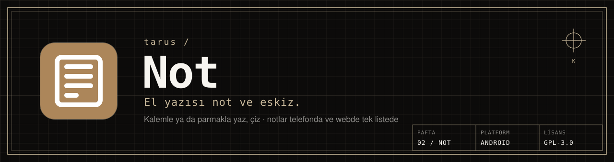
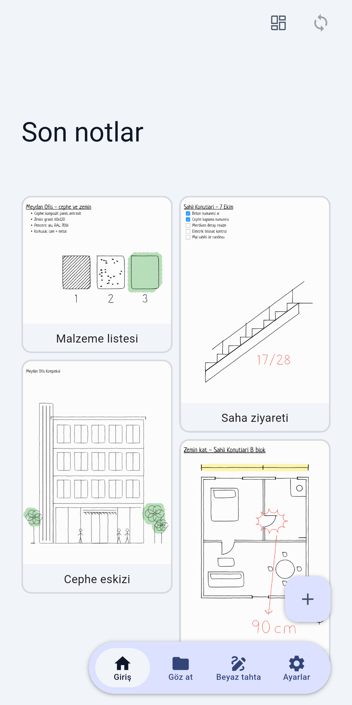
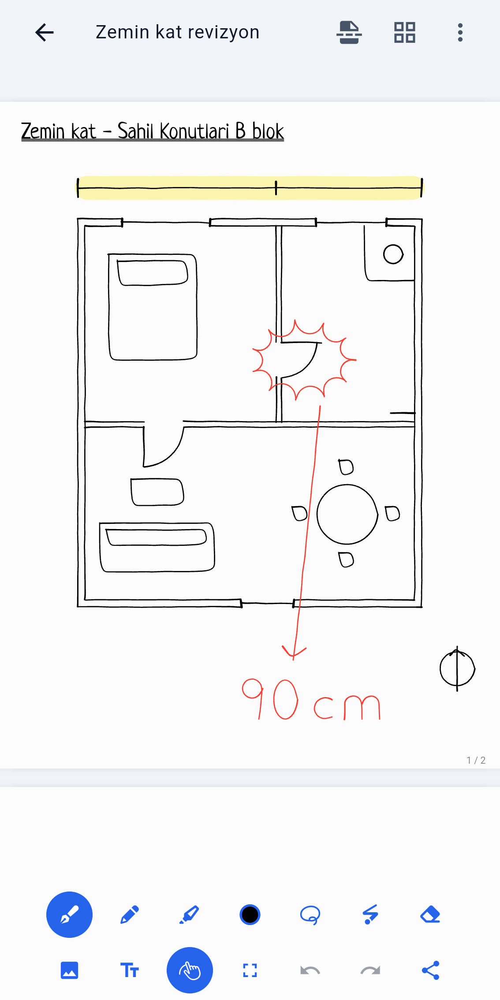
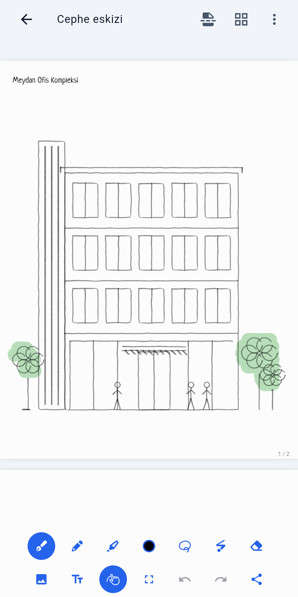
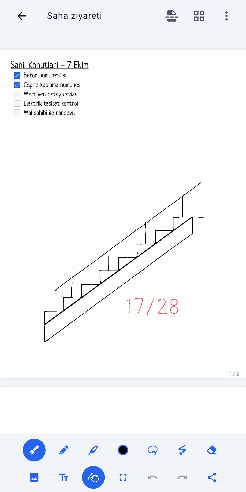

<picture>
  <source media="(prefers-color-scheme: dark)" srcset="docs/readme/afis-koyu.svg">
  <source media="(prefers-color-scheme: light)" srcset="docs/readme/afis-acik.svg">
  
</picture>

<p align="center">
  <a href="LICENSE.md"></a>
  
  <a href="https://github.com/tarusatolye/not-mobil/releases/latest"></a>
</p>

**Not**, tarus ekosisteminin el yazısı not ve eskiz uygulamasıdır. Kalemle ya da parmağınızla yazın, çizin; notlarınız telefonda ve webde ([not.tarus.tr](https://not.tarus.tr)) aynı listede durur. Şantiyede kontrol listesi, toplantıda kat planı eskizi, masada malzeme notu için.

<table>
  <tr>
    <td width="25%"></td>
    <td width="25%"></td>
    <td width="25%"></td>
    <td width="25%"></td>
  </tr>
  <tr>
    <td align="center"><sub><b>01</b> · SON NOTLAR</sub></td>
    <td align="center"><sub><b>02</b> · KAT PLANI</sub></td>
    <td align="center"><sub><b>03</b> · CEPHE</sub></td>
    <td align="center"><sub><b>04</b> · SAHA</sub></td>
  </tr>
</table>

### ◢ Ne yapar

- **El yazısı ve çizim:** kalemler, vurgulayıcı, şekiller; görsel ve PDF üzerine yazma. Sayfalı not ya da beyaz tahta.
- **Karanlık modda ters çevirme:** koyu zemine açık mürekkeple yazarsınız; görseller ve PDF'ler de birlikte çevrilir.
- **Telefon ve web aynı listede:** telefonda yazdığınız not webde, webde açtığınız not telefonda görünür. Çakışmada eski sürüm kaybolmaz, kopya olarak saklanır.
- **Düzen:** iç içe klasörler, ada göre arama, Özel / Şirket İçi / Proje kategorileri.
- **Pusula ile tek hesap:** ayrı hesap yok; Pusula hesabınızla girersiniz. Notlar Pusula projelerine bağlanabilir.
- **İzleme yok:** reklam, analitik ya da üçüncü taraf izleme içermez.

### ◢ Kurulum

Mağaza sürümü henüz yayında değil. Web sürümü: **[not.tarus.tr](https://not.tarus.tr)**

Kaynaktan derlemek için Flutter (depodaki `submodules/flutter`) ve Rust gerekir:

```bash
git clone --recursive https://github.com/tarusatolye/not-mobil.git
cd not-mobil
flutter pub get
flutter build apk --release
```

İmza anahtarı, Play derlemesi ve testler için ayrıntılı kılavuz: [TARUS_NOT.md](TARUS_NOT.md).

### ◢ Lisans ve atıf

Not, açık kaynak **[Saber](https://github.com/saber-notes/saber)** uygulaması (© 2022– Adil Hanney ve katkıda bulunanlar) temel alınarak geliştirilmiştir. tarus, Saber 1.36.1 üzerine arayüz, eşitleme ve giriş akışında değişiklikler yapmıştır (2026); değişikliklerin dökümü [TARUS_NOT.md](TARUS_NOT.md) «Sürüm notları» bölümündedir.

Saber gibi Not da **GNU Genel Kamu Lisansı sürüm 3** ile lisanslıdır: [LICENSE.md](LICENSE.md). Gizlilik politikası: [tarus.tr/gizlilik](https://tarus.tr/gizlilik).

---

<details>
<summary><b>English</b></summary>

**Not** is the handwriting and sketching notes app of the tarus ecosystem. Write and draw with a stylus or finger; notes stay in one list across phone and web ([not.tarus.tr](https://not.tarus.tr)). Sign-in is with a Pusula account. No ads, analytics or third-party tracking.

Not is based on the open-source [Saber](https://github.com/saber-notes/saber) app (© 2022– Adil Hanney and contributors), modified by tarus in 2026, and is licensed under the GNU General Public License v3 ([LICENSE.md](LICENSE.md)). Build notes: [TARUS_NOT.md](TARUS_NOT.md) (Turkish).

</details>

<p align="center"><sub><a href="https://tarus.tr">tarus.tr</a> · <a href="mailto:destek@tarus.tr">destek@tarus.tr</a> · PAFTA 02 · NOT · ÇARŞAMBA, SAMSUN</sub></p>
